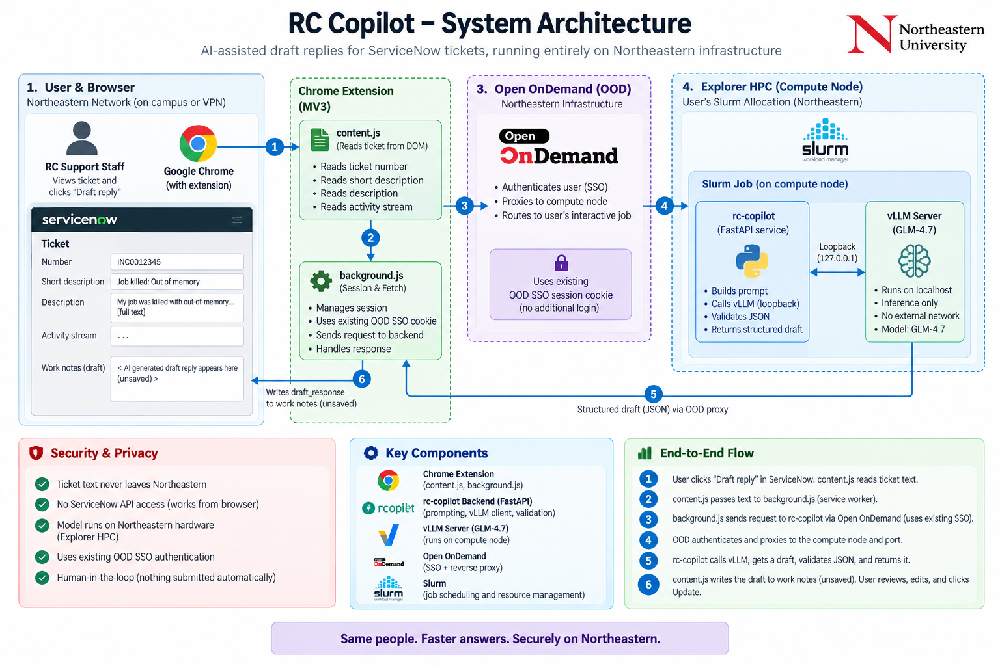

# RC Copilot — Architecture & Developer Guide

How RC Copilot (TicketMate) works, why it is built this way, and where each
piece lives. For setting it up, see the [repository README](../README.md#running-it);
for using it, see [ood-apps/MEMBERS.md](ood-apps/MEMBERS.md).

---

## 1. The problem and the constraints

RC support staff answer ServiceNow tickets that are, in large part,
recognisable: out-of-memory kills, quota limits, module and environment
mistakes, access requests. RC Copilot drafts the reply; a person reviews and
sends it.

Two constraints shape everything:

- **No ServiceNow API access.** Org policy does not grant it, so anything that
  reads a ticket works from what is already on the RC member's screen.
- **Ticket text cannot leave Northeastern.** It contains researcher names and
  unpublished work, which rules out hosted LLM APIs.

So the **browser** is the integration point, and the **model runs inside the
RC member's own Slurm job**, together with everything else that touches the
ticket.

---

## 2. The big picture



```
  Chrome (RC member)                 Open OnDemand                 Slurm job on a GPU node
 ┌──────────────────────────┐      ┌──────────────────┐      ┌──────────────────────────────────┐
 │ ServiceNow ticket page   │      │ SSO + node proxy │      │ rc-copilot backend  0.0.0.0:PORT │
 │  ▲ draft into work notes │      │ /rnode/<n>/<p>   │      │   │ loopback, tokens             │
 │  │ (unsaved)             │      │                  │      │   ├──► vLLM          127.0.0.1   │
 │ extension                │ HTTPS│                  │      │   ├──► rc-kg API     127.0.0.1   │
 │  content.js  reads page  ├─────►│                  ├─────►│   │      └─ Neo4j (node-local)   │
 │  background.js all fetch │      │                  │      │   └──► id / sacct / sinfo ...    │
 └──────────────────────────┘      └──────────────────┘      │        (read-only lookups)       │
                                                             └──────────────────────────────────┘
```

Everything that sees ticket text runs in the job: the backend, the model,
the knowledge graph and the lookups. Only the backend listens on the network,
and only behind OOD's SSO plus its own access token.

---

## 3. One draft, step by step

1. **Read.** The RC member clicks **Draft reply**. `content.js` reads the
   ticket number, short description, description and the activity stream
   (comments, work notes, notifications) out of the page.
2. **Send.** The service worker (`background.js`) signs in if needed and POSTs
   `/api/draft` through OOD, carrying the member's OOD SSO cookie
   ([§8.1](#81-why-the-service-worker-makes-every-request)).
3. **Clean** (`app/ticket_context.py`). The scraped page becomes the context
   the model reads: notification emails, To/Cc/From address lists, signatures
   and quoted chains are dropped; field changes are compressed; every comment
   and work note is kept word for word, oldest first, labelled with date,
   author, **RC staff or researcher**, and whether the researcher could see it.
   On 18 real tickets this halves the text and removes ~35 addresses per
   ticket.
4. **Look up** (`app/lookups.py`), in parallel with retrieval: read-only
   commands for what the ticket names — `id <user>`, `sacct -j <job>`,
   `getent group <name>`, `scontrol show node <node>`, `sinfo -N -p
   <partition>` — run as the RC member inside the job
   ([§7.3](#73-cluster-lookups)).
5. **Retrieve** (`app/kg_client.py` → rc-kg). The search query is the short
   description, the description and the researcher's latest message (not the
   whole thread, whose RC-team wording matched staff pages). rc-kg returns six
   numbered sources `[S1]…` from the RC website and rc-docs
   ([§6](#6-the-knowledge-graph-rc-kg)).
6. **Fit.** The cleaned ticket gets what the model's context window (read
   from vLLM) leaves after the system prompt, sources, lookups and the reply;
   a long thread keeps its description, first and newest entries.
7. **Prompt** (`app/prompts.py`). System prompt (role, JSON contract, rules),
   then the ticket, lookups and sources, the engineer's instructions (which,
   when given, *are* the task), and a short end-of-prompt checklist.
8. **Generate** (`app/llm_client.py`). vLLM returns JSON (constrained
   decoding, with fallbacks — [§5](#5-structured-output)), validated against
   a Pydantic model.
9. **Cite** (rc-kg `/cite`). `[S1]` markers become a numbered References block
   with exact page links. The model never writes a URL; one it writes anyway is
   checked against what was retrieved and removed if it is not there.
10. **Evaluate** (`app/evaluators.py`). Code checks of the prompt's rules
    (sign-off, no placeholder, no invented ticket number, cites when grounded,
    ...) and metrics (conciseness, relevance); an LLM judge grades in the
    background.
11. **Record** (`app/runlog.py`, `app/tracing.py`). One private JSON trace per
    draft — the run tree, exact prompts, tokens, timings, lookups, retrieval —
    under `traces/$USER/` in the repository (mode 700/600), with its spans and a metrics row.
12. **Show.** The panel writes the draft into **work notes** (or the field the
    member chose), unsaved, and shows what to check before sending; steps,
    lookups, cited pages, checks and feedback are one click away.

**Nothing is ever submitted automatically.** A person reviews, edits and clicks
Update.

---

## 4. Components

```
ticketmate/                       the app
  backend/app/                    FastAPI service (knows nothing about ServiceNow)
  backend/web/                    paste-a-ticket web UI, no build step
  extension/                      Chrome MV3 extension (panel on ServiceNow)
  ood-apps/rc-copilot/            the OOD interactive app (one job: vLLM + backend + rc-kg)
  ood-apps/capture-test/          same, no model: stores what is sent, to test the data path
  ood-apps/{publish,install}.sh   release the app for RC members / link it into a sandbox
  cluster/                        sbatch launchers, vLLM install, diagnostics, traces.py
  tests/                          inference, contract, startup, lookups, ticket-context, UI tests
rc-kg/                            the knowledge graph
  ingest/  enrich/  graph/        build: crawl both sites, topics + embeddings, write Neo4j
  retrieval/  api/                serve: hybrid GraphRAG retrieval, citations, HTTP API
  eval/  scripts/                 evaluation; build/serve/instance scripts
```

### 4.1 Backend (`ticketmate/backend/app/`)

| Module | Responsibility |
| --- | --- |
| `main.py` | Routes and the draft pipeline of §3; error shaping; serves `web/` |
| `ticket_context.py` | Clean the scraped ticket, build the retrieval query, fit it to the context window |
| `lookups.py` | Read-only cluster lookups (allowlisted, no shell) |
| `kg_client.py` | rc-kg calls: retrieve, cite, similarity; API-version check |
| `prompts.py` | **The file to iterate on.** System prompt, templates, checklist |
| `llm_client.py` | vLLM calls, structured-output fallback, JSON extraction, token counts, context window |
| `models.py` | Pydantic request/response models and the JSON schema sent to the model |
| `evaluators.py` | Per-draft assertions, metrics, background LLM judge |
| `runlog.py`, `tracing.py` | The private run log and LangSmith-style run trees |
| `startup.py` | Startup progress (vLLM's log, rc-kg's checklist) for `/api/health` |
| `auth.py` | Access token, HMAC-signed sessions |
| `config.py` | Settings from environment / `.env` |

| Endpoint | Auth | Purpose |
| --- | --- | --- |
| `GET /api/health` | none | vLLM, knowledge graph and startup progress (always 200; read the body) |
| `POST /api/login` | access token | Exchange the token for a signed session |
| `POST /api/draft` | session | `{ticket_text, ticket_number?, extra_instructions?}` → draft, references, lookups, context stats, checks |
| `POST /api/feedback` | session | A person's rating/comment/correction, stored beside the draft's trace |

`/api/health` is unauthenticated so the extension can tell "backend down" from
"token wrong" — two failures with very different fixes.

### 4.2 Extension (`ticketmate/extension/`)

| File | Responsibility |
| --- | --- |
| `content.js` | The panel on ServiceNow: read the ticket, compose, show the result, write the draft |
| `background.js` | **All** network I/O, the session, error wording |
| `ood-connect.js` | Runs on OOD; saves the session's address and token from its card |
| `popup.*` | Connection status, target field, manual configuration |
| `check.py` | Static checks run before packaging |

The panel is half the page by default (⅓ / ½ / ⅔, or drag its edge;
remembered). It always shows where the draft went, confidence, *Check before
sending* and the draft; the rest are collapsible sections. Packaged as
`dist/rc-copilot-extension.zip`.

### 4.3 The OOD app and the session

`ood-apps/rc-copilot/template/script.sh.erb` runs in the job, in this order:

1. **rc-kg** (`rc-kg/scripts/serve_kg.sh`): loads the graph snapshot from
   `/projects` into a private Neo4j on node-local disk, with a per-session
   bearer token, on loopback. ~1–2 min; writes a startup checklist.
2. **The backend**, immediately — so the extension can connect and show
   progress while the model loads.
3. **vLLM**, on loopback, with the model and context length from the form.

`publish.sh` copies the app into `rc-copilot/releases/<date>-<commit>/` and
swaps the `current` symlink atomically; members' `~/ondemand/dev/rc-copilot`
is a symlink to it (`install.sh`). The session scripts run TicketMate and
rc-kg straight from the checkout, so backend and graph changes need no
republish; only the OOD templates and the extension zip do.

---

## 5. Structured output

The model is asked for JSON, not prose:

```json
{"problem_summary": "…", "suggested_steps": ["…"], "confidence": 0.86,
 "caveats": ["…"], "draft_response": "…"}
```

Three strategies are tried in order, and the first that works is remembered:
`response_format: json_schema` (constrained decoding), `json_object`, then
prompt-only with a "raw JSON" reminder. Output is parsed tolerantly and
validated; `confidence_label` (high ≥ 0.8, medium ≥ 0.6) is computed
server-side. `caveats` is the *Check before sending* list — shown, never
written into the ticket.

---

## 6. The knowledge graph (rc-kg)

Details in [rc-kg/README.md](../rc-kg/README.md); the essentials:

- **Build** (`scripts/build_graph.sh`, weekly via `rebuild.sbatch`): crawl the
  RC website (WordPress API + sitemap) and rc-docs (Sphinx); split pages into
  sections at headings, with exact anchor URLs; code blocks kept as written;
  embed with `bge-small-en-v1.5`; tag topics; publish a Neo4j dump to
  `rc-kg/data/graph/` **only if** the 45-question eval scores Hit@5 ≥ 0.9.
  People pages, leadership posts and duplicates stay in the graph but are not
  retrievable.
- **Retrieve** (`retrieval/graphrag.py`): vector search and fulltext search
  fused by reciprocal rank, a small topic boost, at most 3 sources per page;
  then graph expansion (neighbouring sections, linked pages, rc-docs links,
  topics). `low_confidence` when the best vector match is under the
  threshold, so the model is told the sources may be unrelated.
- **Variants:** `full` (website + rc-docs, default) and `website`. On the same
  45 questions `full` scores Hit@6 0.98 vs 0.69 — a third of questions are
  answered only in rc-docs ([evidence](../rc-kg/README.md#graph-variants)).
- **API** (versioned, [API_CONTRACT.md](../rc-kg/API_CONTRACT.md)):
  `/health`, `/retrieve`, `/cite`, `/similarity`. A different major version
  makes the backend draft ungrounded with a caveat rather than misread fields.

---

## 7. Security and privacy

### 7.1 The core problem

The backend must bind `0.0.0.0`, because the OOD web node has to reach it
across the network — which means every other cluster user can reach that port
too. Everything else in the job (vLLM, rc-kg, Neo4j) is on loopback, but
loopback is shared by everyone on the node, so rc-kg also requires a token.

### 7.2 Controls

| Control | Detail |
| --- | --- |
| **Access token** | `/api/draft` and `/api/feedback` need a session, from `/api/login` with the job's token |
| **Signed sessions** | HMAC-signed, expiry inside the signature; a forged expiry fails. Lasts the job's hours |
| **Token never on `/projects`** | `/projects` is group-readable. Under OOD the token is the session password, shown only on the owner's session card |
| **Never logged** | Tokens are not printed in job logs; ticket text is not logged unless `DEBUG=true` |
| **Loopback + per-session tokens** | vLLM and rc-kg listen on 127.0.0.1; rc-kg and its Neo4j get random per-session credentials |
| **Extension scoped** | Host permissions cover only `northeastern.edu` / `neu.edu`; `ood-connect.js` refuses other endpoints |
| **Session storage** | The extension keeps its session in `chrome.storage.session` (memory only) |

### 7.3 Cluster lookups

They run as the RC member, on text a researcher wrote, so the rules are
enforced in code, not trusted to the model, which never chooses a command:
only `id`, `getent group`, `sacct`, `scontrol show node` and `sinfo`, each with
a fixed argument list, exec'd without a shell; every argument from the ticket
must fully match a strict pattern; email addresses are never usernames; a few
lookups per draft, 5 s each, output capped. Nothing that changes data is
reachable. `tests/lookups/test_lookups.py` proves that injection text in a
ticket executes nothing. Off with `CLUSTER_LOOKUPS=false`.

### 7.4 Ticket data at rest

The run log (`traces/$USER/runs/<ticket>/<time>-<id>.json` in the repository,
git-ignored) holds ticket text, prompts and drafts, so the per-user tree is
forced to mode 700 and files to 600 (`/projects` is group-readable). Folder
names derived from the page are sanitised. Unlike `/scratch`, it is not purged:
decide a retention period and prune old runs. Set `RUN_LOG_DIR=` (empty) to turn
recording off. The capture-test app stores what it receives the same way.

### 7.5 Trust boundary for auto-configuration

The extension configures itself from the OOD session card, which carries the
endpoint and token. Only the job's owner can see that card — the same boundary
OOD uses for Jupyter and RStudio passwords.

---

## 8. Design decisions worth explaining

### 8.1 Why the service worker makes every request

An MV3 content script runs in the page's origin and is subject to CORS: a
fetch from `service.northeastern.edu` to `ood.explorer.northeastern.edu` is
blocked whatever the backend's headers say. Service-worker fetches are covered
by `host_permissions` and bypass CORS, so all network I/O goes through
`background.js`.

### 8.2 HTML is never the backend

OOD answers with HTML in two very different cases: its login page (SSO
expired) and its own error page when nothing listens yet ("Failed to connect
to d4054:24980" — a new session starts its backend a minute after the card
says Running). `background.js` tells them apart: the first asks you to sign
in, the second waits and retries for five minutes.

### 8.3 Three ServiceNow UIs, one content script

Classic puts the form in an iframe, Next Experience in shadow DOM, Service
Portal uses its own ids. Fields are found by a shadow-piercing DOM walk matched
on id, name, `aria-label`, placeholder and label text. Writes go through the
native value setter and dispatch `input`/`change`, or ServiceNow does not
notice them; `description` explicitly never matches `short description`.

### 8.4 Why the extension needs no configuration

The node and port change with every job. OOD has no sessions API, so RC
Copilot is an OOD interactive app whose own session card carries the details
in markup we control; opening *My Interactive Sessions* configures the
extension.

### 8.5 Work notes by default

Work notes are internal; additional comments reach the researcher. Defaulting
to work notes means a mis-click cannot send unreviewed model output. The other
targets are one choice away in the panel, with a warning.

### 8.6 Why clean the ticket, and why the instructions are the task

A 7B model acts on what it reads last and what its task line says. Raw pages
were half notification noise, and appended instructions ("just write a
follow-up") were ignored in favour of the default full answer. So the ticket
is cleaned and labelled, the engineer's instructions replace the task line,
and a short checklist (cite sources, use the lookups, write what was asked)
closes the prompt.

---

## 9. Deployment notes

### 9.1 vLLM and CUDA

Explorer's GPU nodes run driver **570.86.15**; vLLM 0.29.0's default wheel is
built for CUDA 13 (driver 580+). The failure is a two-stage trap: first
`libcudart.so.13` is missing; "fix" that and vLLM's kernels die with
`cudaErrorInsufficientDriver` while torch keeps working. The fix is the
explicitly tagged `+cu129` wheel (`--torch-backend` alone is not enough);
`cluster/install_vllm.sh` encodes it. Details in
[VLLM_SETUP.md](VLLM_SETUP.md).

### 9.2 Models, GPUs and context windows

| OOD form choice | Model | Context |
| --- | --- | --- |
| default: Qwen2.5-7B AWQ, any free GPU | 4-bit, fits a 16 GB T4 | 16,384 |
| Qwen2.5-14B AWQ | tight on a T4 | 8,192 |
| Qwen2.5-7B fp16 | A100 40 GB | 32,768 |
| GLM-4.7-Flash | A100 80 GB / H200 | 32,768 (131,072 on 2 GPUs) |

A draft's prompt is typically 4–8k tokens. General-access GPU partitions allow
one GPU per job (`gpu-interactive`, `gpu-short`: 2 h; `gpu`: 8 h); 2+ needs
`multigpu` approval. V100s (sm_70) are excluded: torch 2.13+cu129 has no
kernels for them. bfloat16 needs sm80+, so `serve_glm.sh` falls back to
float16 on T4s.

### 9.3 Neo4j and Java

Neo4j 5.26 needs Java 17+, and the compute nodes' default `java` is 11 — on
which Neo4j refuses to run *and exits 0*. rc-kg picks a JDK explicitly (21/17
if installed, else RC's shared OpenJDK 22) and fails fast on a refusal. The
store lives on node-local `/tmp` (Neo4j does not support NFS); each instance
is private, owned, and cleaned up even after a crash.

---

## 10. Tests

| Test | What it proves | Needs |
| --- | --- | --- |
| `tests/rc_kg/run_contract.sh` | The whole draft path against a real rc-kg and a stub model: grounding, citations, traces, evaluators, fallbacks, version mismatch, rc-kg down | no GPU, ~5 min |
| `tests/lookups/test_lookups.py` | Only allowlisted argv runs; injection does nothing; timeouts | nothing |
| `tests/ticket_context/test_ticket_context.py` | Cleaning keeps every message and drops the noise; fitting | nothing |
| `tests/startup/run_slow_start.sh` | Startup progress through a replayed real vLLM log | no GPU |
| `tests/ui/run.sh` | Web UI and the extension panel in headless Chromium | Playwright |
| `tests/run_inference_test.sbatch` | Real inference with the real prompt | a GPU |
| `rc-kg/scripts/contract_test.sh`, `pytest rc-kg/tests` | rc-kg's API contract and units | no GPU |
| `rc-kg/eval/{run,ticket_cases,variants}.py` | Retrieval quality, reviewed-ticket regressions, graph variants | a graph |

---

## 11. Status and open questions

**Working:** real drafts on real tickets with Qwen2.5-7B AWQ, grounded in the
graph, with lookups, cleaned context and per-draft evaluation. Draft quality
is being tuned ticket by ticket from reviewed drafts (`rc-kg/eval/ticket_cases.yaml`);
the in-loop LLM judge is the model grading itself and disagreed with human
reviewers, so people's labels are the ground truth.

**Open:**

1. **Policy.** Reading and writing ticket pages has not been reviewed against
   whatever blocked ServiceNow API access; it should be before wider use.
2. **Distribution.** *Load unpacked* needs Developer mode, which managed Chrome
   profiles may block; the wider team needs the Web Store or a policy push.
3. **GLM-4.7-Flash** is configured and cached but not yet compared with Qwen 7B
   on reviewed tickets.
